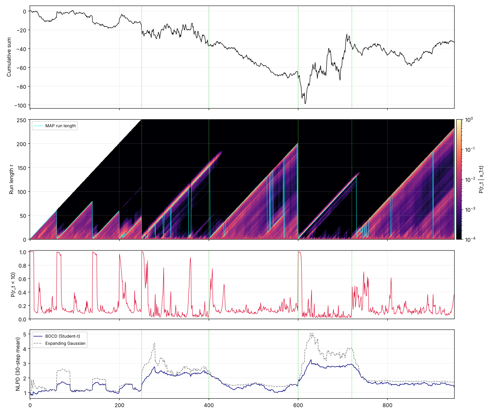

# Causal BOCD: Online Changepoint Detection on Financial Dollar Bars

Bayesian Online Changepoint Detection (Adams & MacKay, 2007) with an exact
Normal-Gamma / Student-t predictive, a decreasing ("regime memory") hazard, and
dollar-bar resampling of prices. Inference is **causal**: at time *t* the model
uses only $x_{1:t}$, and each update costs $O(r_{\max})$, independent of the series length.



*Synthetic series with four known changepoints (green). From top: cumulative sum,
run-length posterior with MAP run length, probability that a new regime started in
the last 10 steps, rolling one-step-ahead NLPD against an expanding-window Gaussian.*

## Model

Within a regime, $x_t \sim \mathcal N(\mu, \tau^{-1})$ with a conjugate Normal-Gamma
prior $(\mu_0, \kappa_0, \alpha_0, \beta_0)$. Integrating out $(\mu,\tau)$, the
predictive for the next point given the last $r$ points is

$$
p(x_t \mid r_{t-1}=r, x^{(r)}) = \text{Student-t}\!\left(x_t \;\middle|\; \mu_r,\ \frac{\beta_r(\kappa_r+1)}{\alpha_r\kappa_r},\ \nu = 2\alpha_r\right).
$$

The run length $r_t$ (time since the last changepoint) is updated by message passing:

$$
P(r_t, x_{1:t}) = \sum_{r_{t-1}} P(r_t \mid r_{t-1})\; p(x_t \mid r_{t-1}, x^{(r)})\; P(r_{t-1}, x_{1:t-1}),
$$

where $P(r_t = 0 \mid r_{t-1}) = H(r_{t-1})$ and $P(r_t = r_{t-1}+1 \mid r_{t-1}) = 1 - H(r_{t-1})$.

**Hazard.** `DecreasingHazard`: $H(r) = 1/(\lambda + r^{\gamma})$ (default $\lambda=50$,
$\gamma=0.5$). Older regimes are a priori less likely to end, a simple encoding of
volatility persistence. With these defaults $H$ moves only from 0.020 to 0.015 over
250 steps, so its effect is mild. `ConstantHazard` gives the usual memoryless prior.

**Truncation.** Run lengths are capped at $r_{\max}$ (default 250). Mass beyond the cap
is merged into the last bin (`truncation="merge"`); see the findings below for why.

**Dollar bars.** Rows are aggregated into a bar whenever the traded dollar volume
since the last bar reaches $V = 1.5 \times$ the mean dollar volume per row
(López de Prado, 2018). To keep the pipeline causal, the mean is estimated on a
burn-in year that is then discarded.

## What the analysis shows

These findings come from re-implementing and testing the original exam notebook.
Each one is backed by a test in `tests/` or by `scripts/demo_synthetic.py`.

1. **$P(r_t = 0 \mid x_{1:t})$ is not a changepoint signal.** It equals a
   predictive-weighted average of $H(r_{t-1})$, so it can never leave the range of
   the hazard: with a constant hazard it is exactly $1/\lambda$ at every step. The
   original notebook plotted this quantity. Use instead the probability of a *recent*
   start, $P(r_t < w \mid x_{1:t})$, or the MAP run length (`prob_recent_change`, `map_run_length`).
2. **Dropping the truncated mass creates false alarms.** Once a regime outlives
   $r_{\max}$, discarding the overflow and renormalising moves probability onto short
   run lengths. In the synthetic test, $P(r_t=0)$ reaches more than twice the hazard
   ceiling. Merging the overflow into the last bin removes the artefact.
3. **Heavy tails protect only young regimes.** The predictive degrees of freedom
   $\nu = 2\alpha_r = 2\alpha_0 + r$ grow with the run length, so within an established
   regime the Student-t is practically Gaussian. In the synthetic demo, three isolated
   6–9σ outliers each push $P(r_t<10)$ above 0.96, so they are read as regime changes.
   A fixed-$\nu$ likelihood or an explicit outlier component would be needed for
   robustness (see Future work).
4. **Variance increases are detected immediately, decreases with a delay.** Synthetic
   detection delays at $P(r_t<10) > 0.5$: 0 steps for both increases (σ 0.8 → 2.5 and
   1.0 → 4.0), 4 and 26 steps for the decreases (σ 2.5 → 1.0 and 4.0 → 1.2).
5. **Better calibrated than a static Gaussian.** Mean one-step NLPD on the synthetic
   series: 1.757 (BOCD) vs 2.097 (expanding Gaussian); the hazard choice changes it
   only in the fourth decimal (1.7572 constant vs 1.7567 decreasing).

Reproduce with `python -m scripts.demo_synthetic` (numbers saved in `figures/synthetic_metrics.json`).

## S&P 500 (2000–2024)

```bash
python -m scripts.run_sp500 --save-csv data/gspc.csv
```

This downloads `^GSPC` daily data with `yfinance` and builds dollar bars from **daily**
rows (each bar groups roughly 1–2 trading days). It runs BOCD with both hazards and the
Gaussian baseline, and writes `figures/sp500_overview.png` and
`results/sp500_metrics.json` with:

- kurtosis of daily vs dollar-bar returns (3 for a Gaussian);
- mean NLPD of each model on the bar returns;
- the first date per year where $P(r_t < 5) > 0.5$.

`--full-sample-threshold` reproduces the original notebook's threshold rule, which
uses future volume. The exam slides (Italian) are in
`Inferenza Causale Sequenziale - Antoine Peluso.pdf`. They were produced by the original
notebook: full-sample threshold, dropped truncation mass, $P(r_t=0)$ as the changepoint signal.

<!-- TODO: add sp500_overview.png and the metrics table after running the script -->

## Limitations

- Dollar bars are built from daily data, so they only aggregate days. The intended
  benefit (sampling by information flow within the day) needs tick or intraday data.
- Univariate, Gaussian-within-regime model; only mean and variance changes are captured.
- Prior $(\mu_0,\kappa_0,\alpha_0,\beta_0) = (0, 1, 2, 1)$ is set for percentage log
  returns and not tuned; results in the first steps of each regime depend on it.
- No trading evaluation: changepoint signals are not turned into positions or P&L.

## Future work

- Intra-bar updating: feed partial-bar observations to the conjugate update before the
  bar closes. The sequential and batch Normal-Gamma updates coincide (tested in
  `test_sequential_updates_equal_batch_conjugate_update`), so this is a data-pipeline
  problem rather than a modelling one.
- Robust likelihood (fixed-$\nu$ Student-t or outlier mixture) to address finding 3.
- Streaming deployment (tick accumulator → message queue → BOCD engine) and latency measurements.
- Financial evaluation: information coefficient of the changepoint signal vs future
  volatility, drawdown and risk-adjusted returns after costs.
- Multivariate BOCD for changes in the covariance structure across assets.

## Usage as a library

```python
from bocd import BOCD, DecreasingHazard

model = BOCD(hazard=DecreasingHazard(lam=50, gamma=0.5), r_max=250)
for x in stream:                    # online
    log_pred = model.update(x)      # log p(x_t | x_1:t-1); model.log_r is the run-length posterior

result = BOCD().run(returns)        # batch
result.prob_recent_change(window=5); result.map_run_length; result.nlpd
```

## Install and test

```bash
pip install -r requirements.txt
pytest
```

## Repository structure

```
bocd/
  model.py       # BOCD with Normal-Gamma prior, Student-t predictive, truncation
  hazards.py     # ConstantHazard, DecreasingHazard
  bars.py        # dollar bars (causal threshold), log returns
  baselines.py   # expanding-window Gaussian predictive
  plotting.py    # overview figure
scripts/
  demo_synthetic.py   # offline demo with known changepoints
  run_sp500.py        # S&P 500 analysis
tests/test_bocd.py    # includes a regression test against the original notebook loop
figures/              # generated figures
```

## References

- R. P. Adams, D. J. C. MacKay. *Bayesian Online Changepoint Detection.* arXiv:0710.3742, 2007.
- M. López de Prado. *Advances in Financial Machine Learning*, ch. 2. Wiley, 2018.
- R. Cont. *Empirical properties of asset returns: stylized facts and statistical issues.* Quantitative Finance, 2001.
- K. P. Murphy. *Conjugate Bayesian analysis of the Gaussian distribution.* Technical note, 2007.
